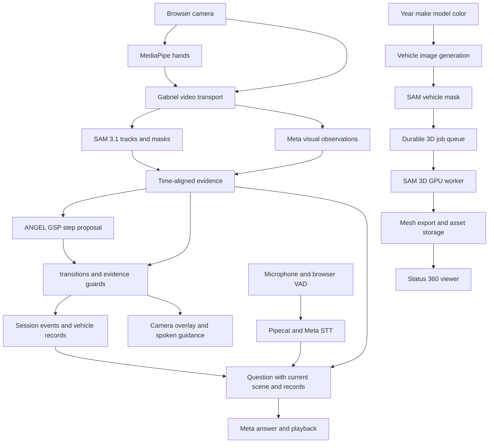

# Carmori 통합 설계 — 비전·음성·개인 차량 3D

작성: 2026-10-27. 상태: 구현 제안, 통합 완료 보고가 아님.
대상: `/Users/joon/Downloads/driveAI`. 기존 React/FastAPI 구조를 확장한다.
목표 일정: 3명, 2026-11-04 14:00. 일정은 America/Los_Angeles 기준으로 가정한다.

## C 구현 현황 — 2026-10-28

- MediaPipe Hand Landmarker 1.2.0을 브라우저 모듈 Worker에서 로컬 WASM/모델로 실행한다. 손 관절을 카메라 위에 표시하고, 선택한 투입구 영역을 손이 떠나면 새 서버 관찰을 요청한다. 손 위치만으로 단계는 전환하지 않는다. 빈 이미지 브라우저 추론으로 로더 동작을 확인했으며 실제 차량 작업 영상 검증은 남았다.
- Status는 차량별 GLB URL을 받을 수 있고, 30 MB 이하의 기본 glTF 2.0 구조를 검사해 저장하는 API가 있다. 차량 식별 정보가 바뀌면 자산 연결을 해제한다. 검증 전 공통 세단은 `Illustrative 3D sedan`으로 표시한다.
- `services/sam3d/generate_splat.py`는 공식 SAM 3D Objects 추론 API를 호출해 생성 차량 이미지와 알파 마스크에서 Gaussian-splat PLY를 만드는 GPU 단계이다. **GPU/체크포인트가 없어 아직 실행 검증하지 못했다.** PLY를 GLB로 변환·검수하는 단계와 자동 job queue는 남았다. 따라서 현재 Status의 3D 차량은 SAM 3D 생성물이 아니다.
- SAM 3.1 영상 세그먼트 API는 A 단계에 있지만, 그 결과를 실시간 카메라 마스크 오버레이로 연결하는 작업은 남았다. 현재 C 오버레이는 손 관절이다.

## 1. 사용자에게 제공할 결과

차량 정보를 등록하면 차종·연식·외장색 기반으로 만든 차량 이미지가 Home에 나타난다. 별도 업로드 없이 그 이미지를 SAM 3D에 전달해 회전 가능한 차량 모델을 생성한다. 촬영한 차량 사진이 이미 있다면 사용자의 선택으로 입력에 사용할 수 있다. 생성 중에도 앱을 사용할 수 있다.

정차 후 휴대폰을 거치하고 안내를 시작하면 손과 물체를 관찰해 워셔액 보충 단계를 자동 진행한다. 작업 중 단계 완료 버튼은 필요 없다. 사용자는 “Is this the right bottle?”, “Repeat that”, “Pause”라고 말할 수 있다. 가려져 확인하지 못한 행동은 자동 완료하지 않는다.

완료 기록은 차량 브리핑과 이후 질문에 함께 쓰인다. 모든 사용자용 문구는 영어를 기본으로 한다.

## 2. 모든 자료의 도입 범위와 완료 증거

| 자료 | 맡길 역할 | 실제 적용의 판정 기준 |
|---|---|---|
| ANGEL System | Global Step Predictor(GSP)를 어댑터로 감싸 시간에 따른 활동 점수에서 단계 후보를 제안 | 고정한 upstream 버전의 GSP 실행 로그, 워셔액용 활동 매핑/설정, 검증 영상 결과 |
| transitions | 허용된 상태 전환, 중단/재개, 후퇴, 완료 이벤트의 최종 실행 | 기존 상태 머신의 회귀 테스트 통과, 전환 경로가 실제 라이브러리를 통과 |
| SAM 3.1 | 캡·주입구·병의 마스크와 시간에 따른 동일 물체 추적 | 연속 영상의 track ID/마스크 기록, 가림 뒤 재탐색 검증 |
| SAM 3D Objects | 차량 이미지와 마스크를 받아 개인 차량 표시용 3D 생성 | 실제 추론 job ID, 입력 해시, 모델 버전, 생성된 mesh와 앱에서의 360도 표시 |
| MediaPipe Hand Landmarker | 브라우저에서 손 관절과 물체 영역의 근접 관계 추출 | 실제 손을 따라 변하는 landmark와 타임스탬프 확인 |
| ricky0123/vad | 발화 시작/종료와 사용자 끼어들기 감지 | 작업 중 버튼 없이 발화가 전달되고 중복 전사되지 않음 |
| Pipecat | 음성 전송·Meta STT·질문 처리·응답 재생 제어 | 실제 Pipecat pipeline으로 발화→답변, 취소/재연결 검증 |
| CMU Gabriel | 영상 전송 흐름 제어와 비전 엔진 실행 | 실제 Gabriel 서버/프로토콜 경유, 지연 주입 시 최신 프레임 우선 처리 |
| Project Astra | 카메라 맥락 유지, 짧은 안내, 가리킨 대상 질문, 작업 기억의 UX 기준 | “this one” 질문과 이전 행동 회상 시연. 공개 Astra SDK를 설치했다는 의미로 표시하지 않음 |

ANGEL 전체 ROS/HoloLens 스택 대신 GSP 부분을 실제 사용한다. GSP가 요구하는 활동 점수는 Carmori의 비전 관찰을 변환한 값이다. 기존 ANGEL 학습 모델이 워셔액 작업을 이미 인식한다고 가정하지 않는다. 이 점수는 검증 영상으로 보정해야 하며 모델의 자기 보고 확신도를 정답 확률로 취급하지 않는다. [ANGEL GSP 공식 설명](https://github.com/PTG-Kitware/angel_system/blob/master/TRAIN_AND_RUN_README.md#the-global-step-predictor-gsp)

## 3. 전체 구조



배포 단위는 웹/FastAPI, Gabriel 비전 서비스, Pipecat 음성 서비스, SAM 3D GPU worker이다. 개발 초기는 같은 호스트에서 CPU 서비스를 운영하되 프로세스와 의존 환경은 분리한다. 3D 추론을 FastAPI 요청 안에서 기다리지 않는다. API 키는 서버에 둔다. 브라우저는 인증된 동일 출처 gateway를 통해 세션에 접속한다.

Gabriel은 영상 경로, Pipecat은 음성 경로를 소유한다. 영상과 오디오를 양쪽에 중복 스트리밍하지 않는다. FastAPI가 차량·세션·작업 기록을 소유하고 transitions만 최종 상태를 변경한다.

## 4. 작업 관찰과 자동 단계 진행

초기에는 MediaPipe를 Web Worker에서 10~15fps 목표로 실행한다. 실제 기기 부하를 측정해 조절한다. 원본 프레임 ID, 촬영 시각, 이미지 크기, 손 좌표를 함께 붙인다. 분석 입력은 회전 방향을 정규화한 원본 좌표계를 사용하고, UI의 crop/미러링 변환은 렌더링 때만 적용한다. 손 추론 실패를 “손이 없음”으로 바꾸지 않는다.

SAM은 캡·병·주입구의 위치를 추적하고, Meta 비전 모델은 워셔액 기호, 라벨, 캡의 열림, 실제 액체 흐름을 판정한다. SAM 마스크가 존재한다고 부품 종류나 작업 완료가 입증되는 것은 아니다. MediaPipe의 손 근접은 관찰 요청을 촉발하는 보조 근거이며 전환 조건을 단독 충족하지 않는다.

SAM 3.1 API가 행사 계정에서 영상 입력과 추적 식별자를 제공하는지 첫날 확인한다. 지원되면 API adapter를 사용한다. 제공되지 않으면 공식 SAM 3.1 video predictor를 별도 GPU 서비스로 실행한다. 독립 이미지의 마스크에 임의 ID를 붙여 영상 추적 완료로 보고하지 않는다. API/로컬 양쪽을 대체할 수 있게 `start`, `observe`, `reseed`, `close` 인터페이스를 둔다. 공식 SAM 3.1은 다중 물체 영상 추적을 제공한다. [SAM 3.1](https://github.com/facebookresearch/sam3/blob/main/RELEASE_SAM3p1.md)

Gabriel은 세션별 영상 producer에 처음에는 token 1개를 부여한다. 분석 중 누적되는 오래된 프레임은 교체하고 최신 입력만 대기시킨다. 비전 엔진이 서로 다른 속도로 응답하므로 `frame_id`와 촬영 시각으로 근거를 결합한다. 가까운 시간 범위에서 일치하는 결과만 사용하며, 카메라가 크게 움직이면 추적을 다시 시작한다. Gabriel 자체가 최신 데이터 전달을 도와도 최종 안내의 시효 검사는 Carmori가 한다. [Gabriel 흐름 제어](https://github.com/cmusatyalab/gabriel#flow-control)

| 현재 단계 | 다음 단계로 넘어갈 필수 근거 | 불충분할 때 |
|---|---|---|
| FIND_INLET | 워셔액 기호와 주입구 후보 확인, 닫힌 캡 관찰 | 기호를 다시 보이도록 안내 |
| OPEN_CAP | 동일 캡의 닫힘→열림 변화, 열린 주입구 관찰 | 손이 가리면 기다림 |
| CONFIRM_PRODUCT | 실제 병 라벨/제품 종류가 워셔액과 일치 | 라벨을 보여 달라고 요청 |
| POUR | 확인한 병이 주입구 위에서 기울고 액체 흐름이 관찰됨 | 기울임만 보이면 완료하지 않음 |
| FINISH | 병이 치워지거나 세워짐, 동일 캡이 닫힘 | 닫는 장면을 다시 확인 |
| RECORDED | 완료 출처·근거와 함께 기록 저장 성공 | 재시도해도 같은 기록을 중복 생성하지 않음 |

병을 바꾸면 CONFIRM_PRODUCT로 되돌린다. 주입이 가려졌으나 마무리는 관찰했다면 음성으로 완료 여부를 묻고 `user_voice_confirmed`로 저장한다. 시각적으로 확인한 완료는 `observed`로 저장한다. 모르는 제품을 “yes”로 승인할 수는 없다.

ANGEL GSP의 순서 누적 결과는 후보이다. 자동 건너뛰기는 비활성화하고, 관찰되지 않은 행동이 시간 경과만으로 완료되지 않도록 한다. GSP가 내부적으로 진행했더라도 transitions가 거절하면 마지막 확정 상태로 정렬한다. GSP를 복원할 수 없다면 저장된 최근 관찰을 재생한다.

transitions는 `auto_transitions=False`로 두고 explicit trigger와 조건 함수만 사용한다. 기존 `_judge`의 부품·제품·가림 검사를 보존해 migration한다. 세션별 잠금과 `state_version` 비교로 음성 중단과 비전 결과의 경합을 막는다. 상태 변화와 완료 기록은 하나의 DB 트랜잭션으로 저장하고, `session_id + attempt + event_type`에 unique 제약을 둔다. [transitions](https://github.com/pytransitions/transitions)

기존의 겹치지 않는 프레임 묶음 두 번 확인 규칙을 초기 기준으로 보존한다. 단, 같은 이미지의 재전송이나 SAM/비전 두 모델의 동일 프레임 응답은 독립 관찰 두 번으로 세지 않는다. 추정 신뢰 임계값과 시간 창은 시연 영상으로 조정한다.

## 5. 공통 관찰·이벤트 계약

관찰 메시지는 다음 필드를 가진다.

```text
session_id, vehicle_id, attempt, state_version, sequence_id
frame_id, source_frame_ids, captured_at, received_at, processed_at
image_width, image_height, orientation, coordinate_space
tracks: [{track_id, category, mask_ref, box, visible, confidence}]
hands: [{hand_id, landmarks, handedness, detected_at}]
facts: [{type, value: yes|no|unknown, object_ids, evidence_frame_ids}]
activity_scores, model_versions, source: live|replay|synthetic
```

세션 시작 시 클라이언트/서버 시각 차이를 추정하고 브라우저의 monotonic clock으로 프레임 나이를 추적한다. 요청 도착 때 신선도와 응답 사용 때 신선도를 모두 검사한다. 이미 지난 장면의 결과는 과거 기록으로 남길 수 있지만 현재 화면 하이라이트나 현재 행동 지시로 재생하지 않는다.

서버 이벤트는 `objects.updated`, `observation.uncertain`, `step.proposed`, `step.changed`, `speech.started`, `speech.cancelled`, `record.saved`, `asset.ready`로 구분한다. 이벤트에는 event ID와 state version을 붙인다. 재접속 시 클라이언트는 서버 snapshot을 받아 복원하고 이전 단계 음성 큐를 폐기한다.

## 6. 음성: VAD와 Pipecat

브라우저가 마이크를 한 번 열고 PCM을 공유한다. ricky0123/vad는 발화 시작/끝 이벤트를 만들고, PCM 스트림은 Pipecat transport로 전송한다. Pipecat의 MetaSTTService가 Muse Voice realtime 전사를 담당한다. 기존 WAV 업로드 전사 경로는 장애 시 대체 경로로 둔다. 정상 세션에서는 한 가지 전사 경로만 활성화한다. [VAD](https://github.com/ricky0123/vad), [Pipecat Meta STT](https://docs.pipecat.ai/api-reference/server/services/stt/meta)

서버는 브라우저 VAD 이벤트를 Pipecat 사용자 발화 이벤트로 변환하는 입력 adapter를 둔다. Meta의 segmentation mode와 맞춰 turn 종료를 한 번만 확정한다. 브라우저와 서버가 각각 독립적으로 응답을 시작하면 중복 답변이 생기므로 `utterance_id`로 중복을 제거한다. 해당 adapter와 Meta STT의 실제 스트림 종료 동작은 첫날 검증 항목이다.

`Pause`, `Resume`, `Repeat`는 명령 경로로 처리한다. 일반 질문은 현재 차량 기록, 현재 단계, 같은 시각의 프레임/물체 ID, 최근 작업 이벤트를 함께 넣어 답한다. 지금 코드의 기록 기반 `/assistant/ask`는 이 시각 맥락까지 확장해야 “Is this one right?”에 답할 수 있다. 대상이 여럿이면 확인 질문을 한다.

MVP 음성 출력은 현재 영어 브라우저 TTS를 Pipecat 출력 이벤트와 연결한다. `speech_id`, `state_version`, 재생 완료 ACK를 사용한다. 사용자가 말하면 해당 speech ID의 재생과 서버 응답 생성을 취소한다. 재생 시 마이크 echo cancellation을 켜고 실제 휴대폰에서 자기 목소리 재인식 여부를 확인한다. 검증되지 않은 기기에서는 현재 반이중 동작으로 내려가며 자연스러운 끼어들기를 지원한다고 표시하지 않는다. 제공되는 Meta TTS 사용 가능 여부는 별도 계약 확인 후 같은 출력 인터페이스로 교체한다.

안내 우선순위는 중단 명령 처리 → 사용자의 질문 응답 → 현재 단계 안내 → 일반 브리핑이다. 과거 단계의 안내를 쌓아 순서대로 읽지 않는다. 운전 감지 브리핑은 사용자가 미리 활성화하고 음성 재생 권한을 해제한 세션에서 한 번만 재생한다. 운전 중에는 정비 작업 모드 진입을 제한한다.

## 7. SAM 3D 개인 차량 생성

```text
확인한 연식·제조사·모델·차체형태·색상
→ 기존 이미지 생성 서비스(차량 전체가 보이는 3/4 시점)
→ SAM 3.1 차량 마스크
→ SAM 3D Objects 이미지 + 마스크 추론
→ textured mesh 추출·GLB export
→ 크기·방향·중심 정규화·용량 최적화·검증
→ 저장 후 vehicle.asset_3d_id 갱신
→ Status의 model-viewer가 실제 생성 자산 표시
```

SAM 3D는 이미지 입력 기반 3D 복원 모델이므로 차종 문자열만 직접 넣지 않는다. 기존 이미지 생성 결과가 부정확하면 3D에도 반영된다. 생성형 시각화임을 표시하며 실제 차량의 정밀 CAD, 결함 검출, 실제 부품 좌표로 취급하지 않는다. 실제 사진도 보이지 않은 면의 정확성을 보장하지 않는다. [SAM 3D Objects](https://github.com/facebookresearch/sam-3d-objects)

브라우저는 `POST /vehicles/{id}/3d-jobs` 요청 후 작업 상태만 조회한다. job 상태는 queued/running/exporting/ready/failed/cancelled이며 취소는 가능한 단계까지만 지원한다. 입력 이미지·마스크·차량 버전·모델 버전·seed·export 버전 해시로 캐시한다. 색상이나 모델이 바뀌면 새 작업을 만들고, 이전 작업이 늦게 끝나도 새 차량 이미지에 연결하지 않는다.

재시작 가능한 DB job 큐에 lease/heartbeat와 제한된 재시도를 둔다. 파일과 job이 준비되기 전에는 ready로 표시하지 않는다. 개발은 SQLite job 테이블과 worker 하나로 시작할 수 있고, 여러 worker를 배포할 때 PostgreSQL 기반 claim/lock으로 전환한다. 생성 파일은 object storage, job 상태는 DB에 보관한다.

현재 model-viewer는 GLB를 표시하므로 Gaussian splat PLY만 생성된 상태는 완료가 아니다. 첫 기술 검증에서 SAM 3D의 mesh 출력과 GLB export를 실제 수행한다. mesh와 Gaussian splat은 서로 다른 자산이며 파일 확장자를 바꿔 대체하지 않는다. 생성 중 Home/Status에는 기존 2D 이미지를 표시한다. 실패 시 2D로 유지하고 재시도할 수 있다.

GPU worker는 공식 Linux/NVIDIA 환경을 별도 구성한다. 공식 설치 기준은 최소 32GB VRAM과 체크포인트 접근 승인이다. Mac의 FastAPI 환경에 직접 설치하는 방식으로 계획하지 않는다. 비용·계정·가중치 접근 확보가 일정의 선행 조건이다. SAM 3.1 로컬 추론까지 필요한 경우 두 작업의 VRAM 수요를 측정해 별도 worker로 분리하거나 3D 배치를 정비 세션이 없는 시간에 실행한다. 단일 GPU에서 동시 실행 가능하다고 가정하지 않는다. [공식 설치 요구사항](https://github.com/facebookresearch/sam-3d-objects/blob/main/doc/setup.md)

3D hotspot은 모델마다 방향·규모가 다르므로 `asset_anchor`를 별도로 저장한다. 데모 차량의 타이어/엔진룸 영역을 검수해 배치하고 검수 전에는 해당 부위 hotspot을 숨긴다. 워셔액 주입구처럼 외관 모델에 보이지 않는 내부 부품은 엔진룸 영역으로 안내한다. 생성 mesh의 임의 점을 정확한 부품 위치라고 표시하지 않는다.

## 8. Astra를 반영할 화면과 기억

작업 화면은 카메라, 현재 단계, 한 문장의 행동 안내, 관찰 상태, 작은 음성 상태로 구성한다. 마스크가 오래되거나 추적을 잃으면 하이라이트를 숨기고 “I lost sight of the cap”이라고 말한다. 발화 중에도 카메라 관찰은 유지하고 상태 전환과 음성 안내를 같은 버전에 맞춘다.

최근 장면과 대화는 세션 기억으로, 확정한 정비 기록은 차량 기억으로 구분한다. “What did I just do?”는 최근 단계 이벤트를, “When did I refill it?”는 완료 기록을 조회한다. 관찰과 사용자의 직접 확인을 답변에서 구분한다. 이 UX는 [Project Astra 공식 소개](https://deepmind.google/models/project-astra/)를 참고한 Carmori 구현이다.

차량 상태의 초록은 “No flagged items in your records”를 뜻한다. 데이터가 없는 경우 회색 Unknown을 별도로 둔다. 노랑/빨강은 저장된 의심/경고 근거에서 파생한다. 3D 이미지 자체에서 차량 건강을 판정하지 않는다.

## 9. 코드 변경 위치와 API

| 기존 위치 | 변경 |
|---|---|
| `web/src/lib/workSession.ts` | Gabriel 연결, frame ID, 재접속, 관찰/상태 이벤트 수신 |
| `web/src/lib/camera.ts` | 좌표계 통일, 프레임 공유, 캡처 메타데이터 |
| 새 `web/src/workers/handLandmarker.ts` | 손 좌표 추론, 장치 부하에 따른 샘플링 |
| `web/src/screens/Work.tsx` | 실제 마스크, 가림/추적 상태, 단계 버전별 안내 |
| `backend/carmori/state_machine.py` | 기존 조건을 보존하며 transitions로 명시적 전환 |
| 새 `services/vision/` | Gabriel engine, SAM provider, 근거 결합, ANGEL GSP adapter |
| `backend/carmori/spark.py` | 구조화된 시각 관찰·현재 장면 질문 인터페이스 |
| 새 `services/voice/` | Pipecat, Meta STT, VAD 이벤트 adapter, 발화 취소 |
| `web/src/lib/voice.ts`, `voiceContext.tsx` | 하나의 마이크 소유자, PCM 전송, 재생 ACK |
| 새 `services/sam3d/` | GPU 환경, 추론, mesh export, asset 검증 |
| `backend/carmori/store.py`, `models.py` | 이벤트·3D job·asset·근거/출처 저장 |
| `web/src/components/StatusVehicle3D.tsx` | 고정 GLB 경로를 검증된 vehicle asset으로 변경 |

새 계약: `POST /sessions/{id}/transport-token`, `GET /sessions/{id}/snapshot`, `WS /vision/{id}`, `WS /voice/{id}`, `GET /sessions/{id}/events`(SSE), `POST /vehicles/{id}/3d-jobs`, `GET /3d-jobs/{job_id}`. 엔드포인트 이름은 제안이며 라이브러리 transport를 감싸는 gateway에서 구현한다. 세션 소유권을 매번 검사하고 내부 모델 서버는 공개하지 않는다.

SQLite의 현재 차량/정비 기록은 유지하며 추가 테이블 `session_events`, `observation_evidence`, `vehicle_assets`, `generation_jobs`, `asset_anchors`를 migration으로 도입한다. 전체 영상은 기본 저장하지 않고 최근 짧은 버퍼와 전환 증거만 사용한다. 테스트 영상은 별도 동의된 fixture로 관리한다.

## 10. 3명 분담과 일정

| 담당 | 책임 | 첫 통합 산출물 |
|---|---|---|
| A — 작업 비전 | Gabriel, SAM 3.1, ANGEL, transitions | 카메라→관찰→자동 단계 전환 API |
| B — 음성·기억 | Pipecat, Meta STT, VAD, 질문 맥락, 브리핑 | 작업 중 음성 질문과 중단/재개 |
| C — 웹·3D | MediaPipe, 오버레이, SAM 3D worker, Status | 손 좌표 이벤트와 생성된 차량 GLB 표시 |

C의 GPU 환경 작업이 병목이 될 수 있으므로 첫날 A와 함께 인프라 확인을 끝낸다. 세 명 모두 같은 데모 차량·병·작업 영상과 API 스키마를 사용한다. 모든 통합 대상의 버전/commit과 라이선스·모델 접근 조건을 고정해 재현한다.

| 일자 | 반드시 확인할 결과 |
|---|---|
| 10/27~10/28 | Meta SAM 영상 지원·STT 실제 호출, ANGEL GSP 독립 실행, SAM 3D GPU/체크포인트 확보와 GLB 1개 생성, 공통 스키마 확정 |
| 10/29 | A: 캡/병 추적, B: 음성 왕복, C: 손 좌표와 생성 GLB를 각각 실기기 확인 |
| 10/30 | 실영상으로 GSP→transitions 연결, 손/마스크 화면 결합, “this bottle” 질문에 같은 프레임 사용 |
| 10/31 | 정상 워셔액 작업 전체 자동 진행과 완료 저장, 브리핑에서 기록 조회 |
| 11/01 | 가림·잘못된 병·병 교체·느린 응답·끊김·발화 중단 처리 |
| 11/02 | 실제 폰/현장 네트워크 성능 측정, 3D 생성 실패/재시도 검증, 코드 통합 마감 |
| 11/03 | 시연 리허설 3회, 마지막 결함 수정, 시연 차량 3D 사전 생성·캐시 |
| 11/04 14:00 이전 | 기능 동결, 실행 확인, 시연 |

모든 기술을 제품 수준으로 완성하는 일정은 아니다. 한 차량·한 작업·검증한 기기에 제한된 통합 프로토타입 일정이다. 첫날 GPU/모델 접근과 GSP 워셔액 매핑이 검증되지 않으면 SAM 3D 또는 자동 진행이 병목이 되며, 모든 기술 실제 적용 완료를 약속할 수 없다. 대체 경로로 시연을 유지하더라도 해당 항목을 완료로 표시하지 않는다.

## 11. 검증과 성능 목표

아래 수치는 측정 전의 목표다. 실제 환경에서 p50/p95와 실패율을 기록해 조정한다.

| 항목 | 완료 조건/목표 |
|---|---|
| 자동 진행 | 정상 작업 3회 연속, 단계 완료 터치 없이 기록까지 성공 |
| 오류 방지 | 잘못된 병·손 가림·병 기울임만 있음·중복 프레임·지난 단계 응답 fixture에서 잘못된 완료 0건 |
| 손/영상 정렬 | crop·회전·미러링 상황에서 동일 프레임 물체와 손 좌표가 일치 |
| 단계 지연 | 충분한 완료 근거 확보 후 UI 전환 p95 3초 목표. 초과하면 기다림 표시 |
| 음성 | 발화 종료→첫 답변 재생 p95 3초 목표, 중단 시 재생 정지 500ms 목표 |
| 서버 경합 | 동시에 pause/vision 응답, 재접속, 중복 completion에서 상태 불일치·중복 기록 0건 |
| 3D | SAM 3D 실제 생성 GLB, 외장색/방향 확인, 모바일에서 드래그 360도 표시; 생성 시간은 실측 후 안내 |
| 실제 적용 증거 | 서비스별 버전, 실제 호출 로그, frame/job/utterance ID, 실영상 리플레이 결과 |

영상 검증은 임계값 보정용과 최종 평가용을 촬영 세션 단위로 나눈다. 같은 영상을 조정과 최종 성능 주장에 함께 사용하지 않는다. 기존 회귀 테스트를 보존하고 지연·가림·병 교체를 포함한 통합 리플레이를 추가한다. 합성 happy-path 테스트 통과는 실제 카메라 인식 성공과 구분한다.

## 12. 구현 착수 순서

첫째, 공통 이벤트 스키마와 첫날 기술 검증을 끝낸다. 둘째, 기존 상태 머신을 transitions로 옮기되 회귀 동작을 보존한다. 셋째, MediaPipe/SAM/Gabriel/ANGEL의 관찰 경로를 연결한다. 넷째, Pipecat 대화가 같은 세션 상태와 시각 맥락을 읽도록 붙인다. SAM 3D worker는 C 담당자가 이 흐름과 병렬로 진행하고, 실제 생성 자산이 검증된 뒤 Status에 연결한다.

최종 시연은 차량 등록·개인 차량 3D → 정차 상태 워셔액 자동 안내 → 작업 중 질문 → 완료 기록 → 차량 브리핑 순서다. 모델 호출 실패, 대체 2D 표시, 사전 생성 자산 사용 여부는 개발용 실행 기록에 남겨 실제 적용 범위를 입증한다.
